<div align="center">



### Ahmad El Mufti — software engineer, Benghazi

A personal portfolio in English and Arabic, built with plain HTML, CSS and JavaScript.

<p>
  
  
  
  
</p>

</div>

---

## Contents

The site is one page, read top to bottom like a catalogue:

| Section | What's there |
| --- | --- |
| **Hero** | Name, portrait, and an entrance animation that "develops" like a photograph |
| **About** | Who I am and how I work |
| **Selected work** | Projects presented as a sale catalogue, with interfaces drawn in HTML |
| **Experience** | Four roles, in order |
| **Education & certificates** | Degrees and credentials |
| **Toolkit** | Languages, frameworks and tools |
| **Contact** | Where to reach me |

## Stack

- **[Vite](https://vitejs.dev/)** for the dev server and build. It is the only dependency.
- **Vanilla HTML, CSS and JS.** No framework.
- **General Sans** for Latin text and **Noto Kufi Arabic** for Arabic.
- **Bilingual.** All copy lives in [`src/i18n.js`](src/i18n.js), and the Arabic version switches the whole layout to right-to-left.

## Getting started

```bash
npm install
npm run dev       # local dev server
npm run build     # production build into dist/
npm run preview   # serve the build
```

Add `?lang=ar` to the URL to open the Arabic version.

The build uses a relative base (`./`), so `dist/` works from any folder or host path.

## Project structure

```
├── index.html          # the whole page
├── src/
│   ├── main.js         # interactions, reveals, language switching
│   ├── i18n.js         # English and Arabic copy
│   └── style.css       # all styles
├── public/
│   ├── assets/         # portrait, wordmark, archive images (WebP)
│   └── favicon-32.png
├── credits.json        # sources and licences for archive images
└── vite.config.js
```

## Notes

- The project interfaces in **Selected work** are drawn in HTML with sample data. They are not screenshots of live systems.
- The archive pictures of Benghazi (a vintage postcard and the Town Hall chandelier) are **public domain**, via Wikimedia Commons. Full attribution is in [`credits.json`](credits.json).

<div align="center">
<sub>Made in Benghazi 🇱🇾</sub>
</div>
